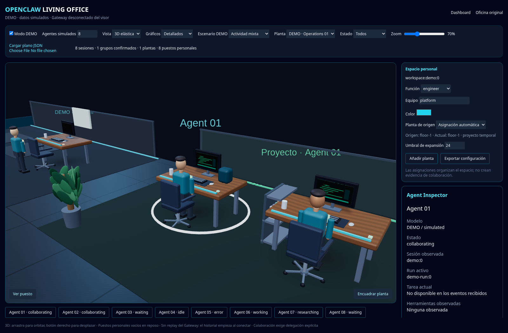

# OpenClaw Living Office

Oficina virtual para monitorizar sesiones de OpenClaw. Basada en
[ruiqili2/agent-monitor](https://github.com/ruiqili2/agent-monitor), conservando
su dashboard y la oficina original.



**Esta captura procede del renderer 3D ejecutado en navegador, con datos DEMO.**
Acabado elegido: **futurista premium**, con mobiliario curvo, superficies de
madera, vidrio ahumado, figuras humanas y detalles cian. `Ver puesto` acerca la
cámara; `Gráficos` permite elegir Automáticos, Detallados o Ligeros.
`/office` ofrece una escena Three.js dinámica, puestos personales con función,
equipo y color configurables, plantas automáticas y áreas temporales de proyecto.
Los puestos conservan su propietario y vuelven a su origen al terminar la colaboración.
La vista 2D sigue disponible; la oficina anterior está en `/office/legacy`.

- [Diseño espacial 3D y comportamiento elástico](docs/LIVING_OFFICE_SPATIAL_DESIGN.md)
- [Arquitectura y plan de implementación](docs/LIVING_OFFICE_ARCHITECTURE.md)
- [Validación y limitaciones](docs/LIVING_OFFICE_VALIDATION.md)
- [Ver el acabado premium de cerca](docs/images/living-office-premium-detail.png)
- [Ver la planta completa](docs/images/living-office-3d-live.png)
- [Comparar las referencias artísticas](docs/LIVING_OFFICE_VISUAL_OPTIONS.md)
- [Concepto artístico original (no es la implementación)](docs/images/living-office-concept.png)

116 pruebas aprobadas; TypeScript y build correctos. Escena WebGL y flujo de
100 puestos probados en Chromium local. La conexión al Gateway sigue siendo de
solo lectura y está pendiente de validación productiva autorizada.
La colaboración requiere evidencia explícita; los perfiles organizativos no la inventan.

## Desarrollo

```sh
npm ci --ignore-scripts --cache /tmp/living-npm-cache --no-audit --no-fund
npm test
npm run dev -- --port 3050
```

Ruta de desarrollo: `/office` en el puerto 3050.

No instalar plugins ni reiniciar OpenClaw productivo para probar esta interfaz.
Ver la documentación para arrancar en modo aislado sin credenciales productivas.

---

## Documentación del proyecto original

# AgentMonitor for OpenClaw

Real-time AI agent visualization and control dashboard for [OpenClaw](https://github.com/openclaw/openclaw).

Watch your agents work in a pixel-art office, monitor live sessions, send direct and global boss chat, and run autowork from the browser.


---

## What Is Included

- Live dashboard with agent cards, activity feed, system stats, and a mini office view
- Global boss chat that broadcasts to all primary agents using the configured boss identity
- Per-agent direct chat with history loading
- Server-side autowork ticker with per-session policies and a run-now action
- Local OpenClaw auto-connect with reconnect retries
- Persistent backend WebSocket connection to the OpenClaw gateway
- Expanded settings panel for Gateway, Boss, Agents, and Theme
- Optional demo mode for UI-only previewing

---

## Quick Start

### Standalone dashboard

```bash
git clone https://github.com/Franzferdinan51/agent-monitor-openclaw-dashboard.git
cd agent-monitor-openclaw-dashboard
npm install
npm run dev -- --port 3050
```

Ruta de desarrollo: `/office` en el puerto 3050.

Open `http://localhost:3000`.

If OpenClaw is already running locally, the dashboard will:

- read `~/.openclaw/openclaw.json`
- auto-discover the local gateway port
- retry until the gateway is available
- authenticate with a persisted local device identity so current OpenClaw builds grant real operator scopes

Demo mode is off by default now. Enable it only from Settings if you want a simulated UI.

### Startup scripts

Windows:

```bat
install.bat
startup.bat
```

Linux/macOS:

```bash
chmod +x install.sh startup.sh
./install.sh
./startup.sh
```

`startup` will install and build when needed, then launch the app.

### OpenClaw plugin mode

If you are using the packaged plugin path:

```bash
openclaw plugins install @openclaw/agent-monitor
openclaw gateway restart
```

The monitor plugin serves the dashboard separately (default plugin port: `3200`).

---

## Local OpenClaw Connection

The standalone dashboard is designed to auto-connect to a local OpenClaw instance.

It uses:

- local config discovery from `~/.openclaw/openclaw.json`
- a persistent backend gateway socket
- device-aware handshake signing for modern OpenClaw gateway auth
- automatic reconnect if the gateway restarts

If you still want manual overrides, use either:

- URL params: `http://localhost:3000?gateway=http://localhost:18789&token=YOUR_TOKEN`
- Settings -> Gateway tab

Saved gateway URL and token are treated as overrides and diagnostics helpers. The dashboard still tries local auto-discovery first.

---

## Main Features

### Dashboard

- Agent cards with live status, token usage, tool/activity summary, and restart controls
- System stats for total agents, active agents, tokens, threads, and broadcasts
- Activity feed for state changes, tool calls, and message events
- Mini office preview rendered on the main page

### Global boss chat

- Broadcast a single message to all main agents
- Sender name and emoji come from the configured boss identity
- Broadcasts are mirrored into the global timeline and agent threads

### Direct chat

- Open a chat drawer for any agent
- Send messages with `chat.send`
- Pull recent history with `chat.history`
- Poll for replies after send

### Autowork

- Global default directive
- Per-session autowork enable/disable
- Per-session interval and directive override
- Manual "run now" execution
- Server-side ticker so autowork continues while the dashboard backend is up

### Office view

- Pixel-art isometric office rendering
- Agent behaviors mapped into office states and movement
- Animated characters, particles, and room transitions

### Settings

The settings modal now has four sections:

- Gateway
- Boss
- Agents
- Theme

You can manage:

- demo mode
- saved gateway overrides
- boss name, emoji, and avatar
- saved agent display presets
- theme selection
- reset of stored local preferences

---

## Architecture

```text
plugin.ts                  OpenClaw plugin entry point
openclaw.plugin.json       Plugin manifest
src/
  app/
    page.tsx               Main dashboard
    office/page.tsx        Office page
    agent/[id]/page.tsx    Agent detail page
    api/gateway/           Gateway-backed API routes
  components/
    dashboard/             Dashboard widgets
    chat/                  Direct and global chat UI
    office/                Office canvas UI
    settings/              Settings panel
  hooks/
    useAgents.ts           Dashboard state, reconnect loop, chat flow
  lib/
    gateway-connection.ts  Persistent gateway connection and device auth
    autowork.ts            Autowork policy store and ticker
    config.ts              Local dashboard config persistence
    state-mapper.ts        Session state to UI state mapping
    types.ts               Shared types
```

### How it works

1. `useAgents` polls `/api/gateway` every 5 seconds until the local gateway answers.
2. The Next.js backend maintains a shared persistent WebSocket connection to OpenClaw.
3. The connection authenticates with local device identity and signed `connect` payloads.
4. `/api/gateway/events` streams live gateway-derived state over SSE.
5. The UI maps live gateway state into office behavior, stats, feeds, and chat views.

### Gateway methods used

- `sessions.list`
- `agents.list`
- `chat.send`
- `chat.history`
- `sessions.reset`
- `sessions.compact`
- `agent` and `chat` event streams for live state updates

---

## Development

### Scripts

```bash
npm run dev
npm run build
npm run start
npm test
```

### Test status

- 92 tests passing
- Vitest + Testing Library

Coverage areas include:

- config loading and mutation helpers
- gateway client helpers
- API route smoke tests
- type consistency
- state mapping logic

---

## Notes

- The dashboard no longer defaults to demo mode.
- Local OpenClaw discovery is the preferred path.
- The boss user is the sender in global chat.
- Autowork is integrated into the live dashboard flow.

---

## License

[MIT](LICENSE)
