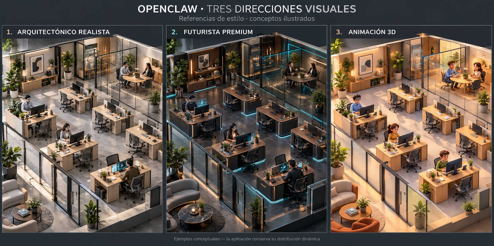

# Tres direcciones visuales

Esta imagen presenta referencias ilustradas, no capturas del renderer. La escena
implementada sigue siendo una oficina dinámica construida con objetos 3D.

1. **Arquitectónico realista:** proporciones naturales, madera y vidrio, iluminación
   suave, estética de visualización arquitectónica.
2. **Futurista premium:** materiales oscuros, mobiliario refinado, iluminación cian
   discreta y apariencia de oficina tecnológica profesional.
3. **Animación 3D:** personajes expresivos, superficies suaves y acabado de película
   de animación. No utiliza píxeles ni geometría de bloques.

La distribución, los puestos vacíos, las plantas y los cambios por colaboración
son independientes de la dirección artística elegida. Alcanzar el detalle de
estas referencias requiere modelado/activos 3D de producción y validación de
rendimiento; la imagen no representa una promesa de equivalencia automática.
